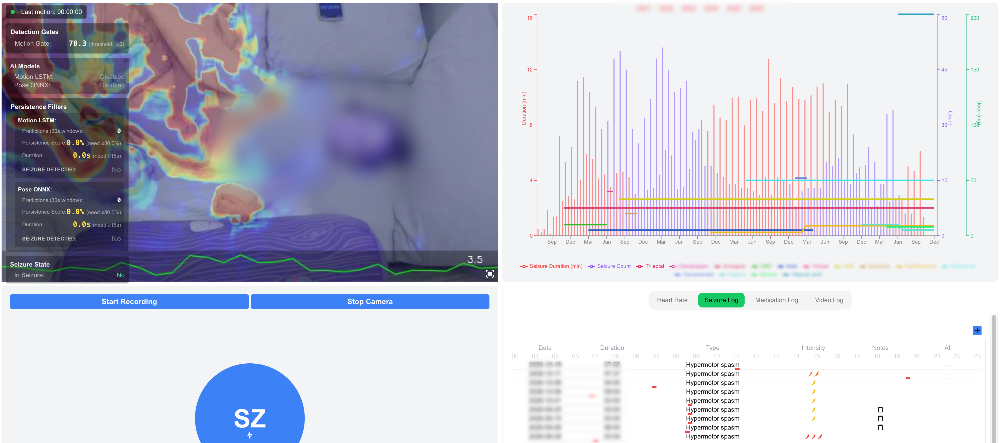

# Seizure Detection App



Next.js dashboard for the [seizure-detection-server](https://github.com/CURE5/seizure-detection-server):
live camera view, heart-rate graph, seizure and medication logs, recorded video
browser, and controls for the Raspberry Pi that runs it all.

Published by [CURE5](https://github.com/CURE5) together with the server as a
reference implementation for home seizure monitoring.

> **Not a medical device.** The system behind this dashboard has not been
> clinically validated. See the server README for what does and does not work.

## Stack

Next.js 15 (App Router), React 19, Tailwind CSS, NextUI, Chart.js and Recharts, a
small Express wrapper (`server.js`) that proxies `/proxy/*` to the Python API, and
a few API routes that drive PM2 and the Pi (restart, stop, reboot, shutdown).

## Development

```bash
yarn install
cp .env.example .env      # point it at a running detection server
yarn dev                  # http://localhost:3000
```

`yarn dev_next` runs Next directly on port 3344 without the Express proxy, which is
handy when you only work on UI.

Checks:

```bash
yarn lint
yarn typecheck
```

## Configuration

Everything is in `.env`; `.env.example` explains each key. The two you will
always set are `NEXT_PUBLIC_FASTAPI_IP` (where the Python server runs, from the
Node process's point of view) and `NEXT_PUBLIC_NEXT_SOCKET_URL` (the Python
server's WebSocket as reachable from the browser).

### Control endpoints

`/api/pm2/*` and `/api/pi/*` execute `pm2`, `sudo reboot` and `sudo shutdown` on
the host. They are meant for a dashboard that sits behind an authenticated tunnel
(for example Cloudflare Access). To add a second layer, set `PM2_API_KEY` and
`NEXT_PUBLIC_PM2_API_KEY` to the same secret; requests without the matching
`x-api-key` header are then rejected. The reboot and shutdown routes also need
passwordless sudo for those two commands:

```
# sudo visudo
pi ALL=(ALL) NOPASSWD: /sbin/reboot, /sbin/shutdown
```

## Deployment on the Raspberry Pi

The app runs under PM2 next to the Python server. The server repository's
`ecosystem.config.js` defines both processes.

```bash
# on the Pi, once
git clone https://github.com/CURE5/seizure-detection-app.git ~/seizure-detection-app
cd ~/seizure-detection-app && cp .env.example .env && yarn install && yarn build
pm2 start ../seizure-detection-server/ecosystem.config.js --only app
pm2 save && pm2 startup
```

From your workstation afterwards:

```bash
PI_HOST=pi@my-pi.local yarn deploy          # this app
PI_HOST=pi@my-pi.local yarn deploy_server   # the Python server
```

`deploy.sh` (runs on the Pi) and `deploy_remote.sh` (runs locally) read `PI_HOST`
and `APP_DIR` from the environment; no hostnames are hard-coded.

### Pulling data off the Pi

`backup_data_only.sh` rsyncs seizure, medication and heart-rate logs and the last
seven days of recordings to `./daily_backups/`:

```bash
PI_HOST=pi@my-pi.local yarn backup_data
```

The backups contain health data and video of a person. `daily_backups/`,
`public/recorded_video*/` and `.env*` are git-ignored; keep them that way.

## Pi housekeeping

```bash
pm2 list && pm2 logs            # process state and logs
sudo lsof -i :8000              # who holds the API port
rpi-connect status              # Raspberry Pi Connect, if you use it
```

Running the Pi headless (no desktop session) saves roughly a third of its idle
power and a few hundred megabytes of RAM.

## License

MIT. See [LICENSE](LICENSE).
